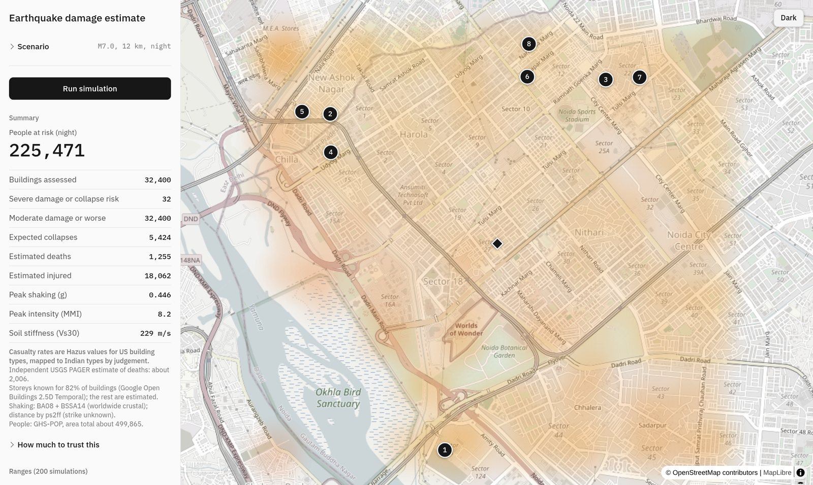

# Disaster Simulation: Quake Damage Map

A city-scale disaster damage estimator that runs in your browser. Describe a scenario (an **earthquake**, a **cyclone** or a **flood**) and an interactive map shows how hard each part of the city is hit, which buildings are likely damaged, how many people are at risk, which neighbourhoods need responders first, and how responders could reach them. You can zoom from the whole city down to individual buildings, in 2D or 3D.

It is built on open data (Overture/OpenStreetMap building footprints, Google Open Buildings heights, GHSL population, USGS soil data) and open, published methods. Uncertainty and data quality are shown, not hidden.



> **Status: research prototype.** The full pipeline runs on real data (tested on Noida, 483,358 buildings, and central Delhi, 1.2 million), but several inputs are still **uncalibrated placeholders**, most importantly the building fragility curves. Use the numbers to **compare areas and scenarios**, not as predictions. See [What is solid and what is a placeholder](quake-map/disaster/README.md#31-what-is-solid-what-is-a-placeholder).

---

## Features

| | |
|---|---|
| **Any area** | Drag a box (up to ~30 km across) anywhere in the world; buildings download in the background and are saved for reuse. Switch between saved areas from a list. |
| **Earthquakes** | Epicentre, depth, magnitude, time of day; optional strike, dip and rake for a finite rupture. Ground motion from BA08 / BSSA14 (+ Sharma 2009 in the Himalaya), checked against OpenQuake. |
| **Cyclones and floods** | Holland (1980) wind field along a straight track; flood depth from any GeoTIFF (for example a JRC return-period map). |
| **Building-level damage** | Each building's chance of heavy damage and collapse, construction type probabilities, storeys (measured or estimated) and occupants. Click any building for details. |
| **Uncertainty** | 200 Monte Carlo runs give 10th to 90th percentile ranges for people at risk, collapses, deaths and injuries, plus a worst-case priority list. |
| **Casualties** | Deaths and injuries by severity (Hazus 6.1 rates), with an independent USGS PAGER cross-check. |
| **Priorities** | The 8 most at-risk neighbourhoods, named from OpenStreetMap. |
| **Responders** | Hospitals, fire and police stations, shelters (greyed out when their building is likely damaged); the chance debris blocks each street; travel time to the nearest working hospital; routes and a suggested dispatch order. |
| **Exports** | PDF report, CSV table and map image. |
| **Extras** | 3D view, seismic-wave animation with warning times, dark theme, a "How much to trust this" panel. |

---

## Setup

You need **Python 3.10 or newer** (developed on 3.14) and an internet connection the first time you load an area.

```bash
git clone https://github.com/HilalAhmad01/Disaster-Simulation.git
cd Disaster-Simulation/quake-map/disaster

python -m venv .venv
source .venv/bin/activate            # Windows: .venv\Scripts\activate
pip install -r requirements.txt
```

The PDF report uses WeasyPrint, which needs the Pango libraries from your system:

- Debian/Ubuntu: `sudo apt install libpango-1.0-0 libpangoft2-1.0-0`
- Arch: `sudo pacman -S pango`
- macOS: `brew install pango`

Everything else works without them.

### Run

```bash
uvicorn app:app --reload             # then open http://localhost:8000
```

A fresh clone starts with no data, and the page tells you so:

1. Press **Load a new area** and drag a box over a city. The download runs in the background with a progress bar. Large cities take a few minutes the first time.
2. Choose a hazard and its settings, then press **Run simulation** (or press Enter in any field).
3. Explore: zoom in past street level to see individual buildings, click one for details, or press a neighbourhood in the list to fly there.
4. Optional: **Show hospitals, fire stations and roads**, then **Estimate hospital access**, then **Route** and **Suggest dispatch order**.
5. Export with **Report (PDF)**, **Table (CSV)** or **Save map as image**.

| Environment variable | Purpose |
|---|---|
| `QUAKE_DATA_DIR` | Where areas and rasters are stored (default `quake-map/disaster/data/`) |
| `DEFAULT_CENTER` | `"lon,lat"` for the empty map (default Noida) |
| `VS30_TIF`, `VS30_OVERRIDE_TIF` | Use a different soil raster, or a local microzonation map |

### Better results with optional data

The app runs without any of these and says what is missing. Each one replaces a guess with measured data. Run them from `quake-map/disaster/` with the virtual environment active. Area ids are shown in the saved-area list.

| Adds | Command |
|---|---|
| Measured storeys (Google Open Buildings heights) | `python tools/get_google_heights.py --area <id>` |
| Population (GHSL GHS-POP) | `python tools/get_ghs_pop.py --area <id>` |
| Soil stiffness (USGS Vs30 grid, 610 MB download) | `python tools/get_vs30.py` |
| A flood scenario (JRC return-period map) | `python tools/get_jrc_flood.py --bbox w,s,e,n --rp 100 --name <name>` |
| Faster 2D/3D maps (vector tiles) | `sh tools/install_tippecanoe.sh` (needs g++, make, zlib and sqlite headers) |
| A whole region downloaded in advance | `python tools/prefetch_region.py --bbox w,s,e,n --name <name>` |

After adding a raster, the area rebuilds automatically the next time it loads. The full list, including calibration and validation data, is in the [detailed README](quake-map/disaster/README.md#63-add-data-for-the-best-results-all-optional-the-app-says-what-is-missing).

### Tests

```bash
pytest -q                            # about 150 tests, no network needed
```

---

## What's new

### Latest update: bug, UI and performance pass

No model numbers changed: the uncertainty ranges are identical to before.

**Faster**
- Uncertainty ranges arrive about **twice as fast** on large cities (60 s to 31 s on Noida's 483k buildings).
- Running a new scenario cancels the previous scenario's background uncertainty run instead of letting it block the queue.
- Memory no longer grows over a long session, and flood uploads stream to disk instead of being held in memory (up to 300 MB).
- Reports are no longer slow when the place-name service is unreachable.

**Fixed**
- The PDF report no longer fails when a dispatched team has no open route, and its title and labels match the hazard. Before, every report said "Earthquake", even for cyclones and floods.
- Results from a previous run (access circles, routes, wave rings, warning colours) no longer stay on the map after a new run.
- Switching area resets the responder tools. Before, the old area's hospitals and Route buttons stayed on screen and then failed.
- Building popups describe the hazard actually on the map, even after the hazard selector is changed.
- Background-task progress no longer polls forever if the server is restarted.
- The flood file is uploaded once instead of on every run.

**Easier to use**
- Clear messages for invalid or empty inputs (for example "Magnitude must be between 3 and 9.5"). Before, an empty box silently became 0.
- Enter runs the scenario; Esc cancels epicentre picking or box selection.
- Dark mode no longer flashes light on load, and map outlines and the fault line stay visible in it.
- Fixed popup glitches (the close button, and the arrow on side-anchored popups); the saved map image uses the right font and wording.

### Recent model work

- **Real data in place of placeholders:** Hazus 6.1 casualty rates per building type, corrected PAGER India parameters, Census 2011 construction shares, Hazus time-of-day occupancy, the USGS Vs30 soil grid, the JRC Asia flood depth-damage curve.
- **Debris blocking streets** now follows Anelli et al. (2020): a street counts as blocked when less than 3.5 m stays clear.
- **Storeys** for buildings that the height product cannot resolve come from a satellite-supervised model instead of an area rule.
- **Validation:** a fragility fit on the Nepal 2015 survey (762k buildings) was run and rejected because it had no held-out skill; comparisons with GEM curves and the Gorkha earthquake felt in Delhi are documented.
- **Static vector tiles** for fast 2D and 3D maps of very large areas.

The complete history, with the effect of every change on the numbers, is in [CHANGELOG.md](quake-map/disaster/CHANGELOG.md).

---

## How it works

```
scenario (earthquake | cyclone | flood) + time of day
   │
   ├─ 1. Hazard     shaking per building (finite-fault distance, ground-motion models, soil)
   │                · wind gusts (Holland 1980) · water depth (raster)
   ├─ 2. Exposure   footprints → storeys, construction-type probabilities, people (night/day/commute)
   ├─ 3. Damage     fragility curves mixed over construction types → chance of each damage state
   ├─ 4. Impact     people at risk, collapses, casualties
   └─ 5. Aggregate  500 m cells → heat map, priority neighbourhoods, uncertainty ranges,
                    road blockage, hospital access, routes, dispatch
```

Map colours: blue = little or no damage, green = light, yellow = moderate, red = severe or collapse risk.

---

## Project layout

```
README.md                  this file
MASTER_PLAN.md             implementation plan and checklist
quake-map/disaster/
  app.py                   web server (FastAPI) and API
  index.html               the whole front end (MapLibre)
  simulate.py              the model: hazard → damage → impact
  hazards/                 earthquake, cyclone, flood plug-ins
  uncertainty.py           Monte Carlo ranges
  responder_layer.py …     facilities, roads, access, routes, dispatch
  report.py                PDF and CSV export
  priors/                  shipped tables (fragility, casualty rates, census, occupancy)
  tools/                   data downloads, calibration, validation, baselines
  tests/                   test suite
  docs/                    method notes, validation and calibration reports
  data/                    your downloaded data (not in git)
```

## Documentation

- [Detailed README](quake-map/disaster/README.md): methods, every placeholder, settings, API, troubleshooting
- [CHANGELOG](quake-map/disaster/CHANGELOG.md): every change and its effect on the numbers
- [Validation](quake-map/disaster/docs/validation.md), [calibration](quake-map/disaster/docs/calibration/README.md), [roads and debris](quake-map/disaster/docs/roads.md), [data sources](quake-map/disaster/docs/data_sources.md)

## Data sources and attribution

Buildings: Overture Maps Foundation and OpenStreetMap contributors. Map tiles: © OpenStreetMap contributors. Population: GHSL GHS-POP (European Commission JRC). Heights: Google Open Buildings 2.5D Temporal. Soil: USGS global Vs30. Flood maps: JRC global river flood hazard maps. Ground-motion models: Boore & Atkinson 2008, Boore et al. 2014, Sharma et al. 2009. Casualty rates: FEMA Hazus 6.1.

Estimates are for planning and comparison, not confirmed damage.
