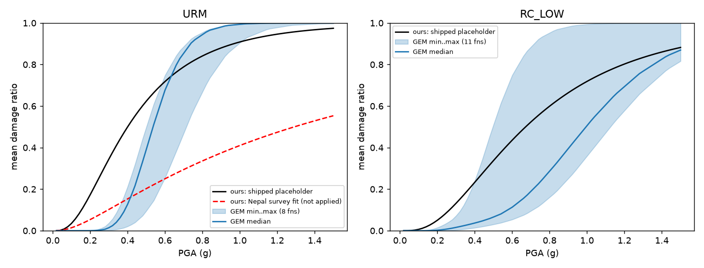

# Comparison with GEM vulnerability functions (plan 3.5)

Mean structural damage ratio against PGA. Ours: MDR = sum P(DS=k) x (0.02, 0.10, 0.50, 1.00) (assumed ratios). GEM: `meanLRs` of the GEM Global Vulnerability Model v2026.0.0 (CC BY-NC-SA 4.0), Nepal and India files, low-rise (H:1-2) classes with PGA as intensity measure; band = min..max over the matching functions, line = median.

| Class | GEM functions | PGA (g) | GEM MDR (min / median / max) | Ours (placeholder) | Ours (Nepal fit, NOT applied) |
|---|---|---|---|---|---|
| URM | 8 | 0.10 | 0.000 / 0.000 / 0.000 | 0.035 | 0.014 |
| URM | 8 | 0.20 | 0.000 / 0.000 / 0.001 | 0.173 | 0.053 |
| URM | 8 | 0.30 | 0.002 / 0.014 / 0.037 | 0.345 | 0.102 |
| URM | 8 | 0.50 | 0.095 / 0.391 / 0.498 | 0.623 | 0.202 |
| URM | 8 | 0.80 | 0.668 / 0.944 / 0.954 | 0.841 | 0.336 |
| URM | 8 | 1.20 | 0.978 / 0.999 / 0.999 | 0.946 | 0.474 |
| RC_LOW | 11 | 0.10 | 0.000 / 0.000 / 0.000 | 0.006 | n/a (fit degenerate or missing) |
| RC_LOW | 11 | 0.20 | 0.000 / 0.002 / 0.015 | 0.050 | n/a (fit degenerate or missing) |
| RC_LOW | 11 | 0.30 | 0.004 / 0.016 / 0.072 | 0.132 | n/a (fit degenerate or missing) |
| RC_LOW | 11 | 0.50 | 0.030 / 0.066 / 0.510 | 0.337 | n/a (fit degenerate or missing) |
| RC_LOW | 11 | 0.80 | 0.161 / 0.287 / 0.953 | 0.599 | n/a (fit degenerate or missing) |
| RC_LOW | 11 | 1.20 | 0.578 / 0.694 / 0.999 | 0.802 | n/a (fit degenerate or missing) |

